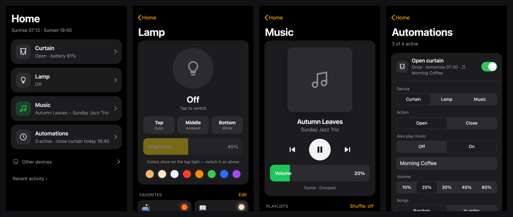
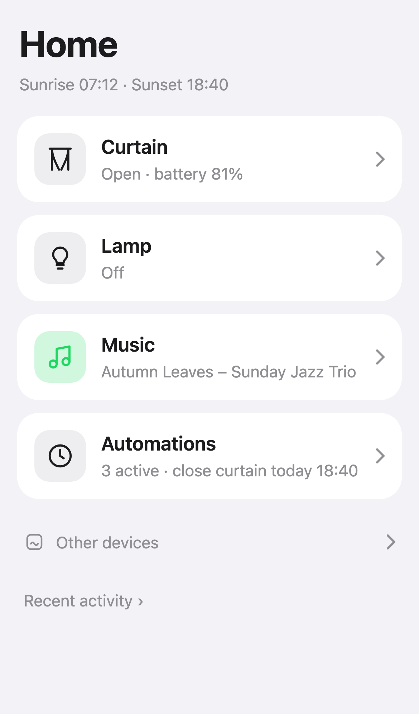
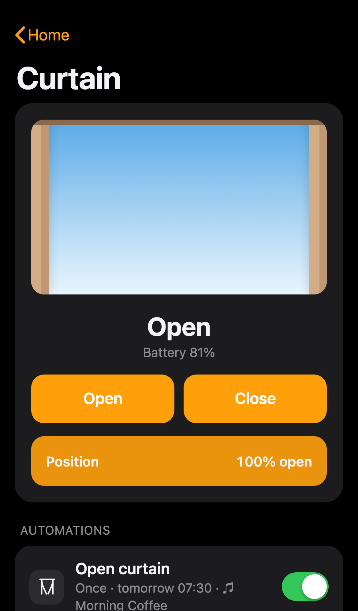
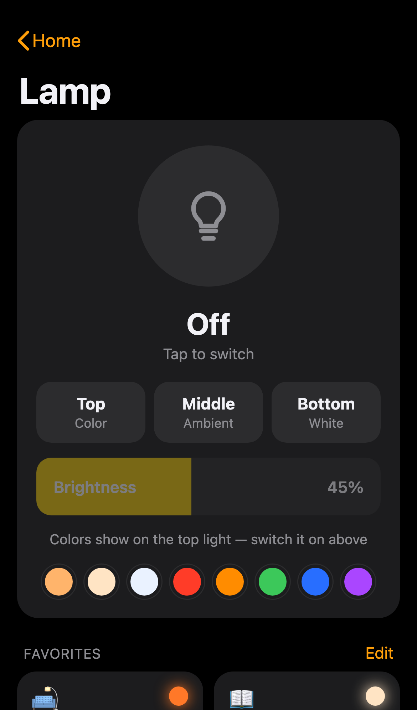
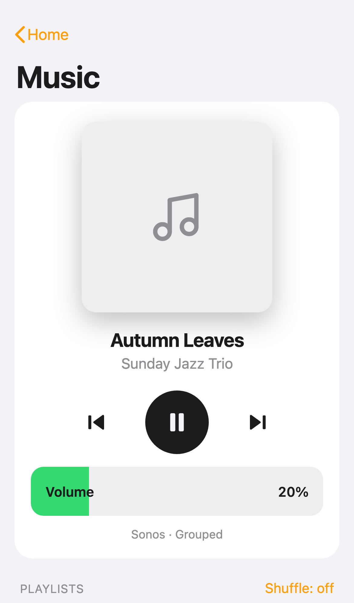
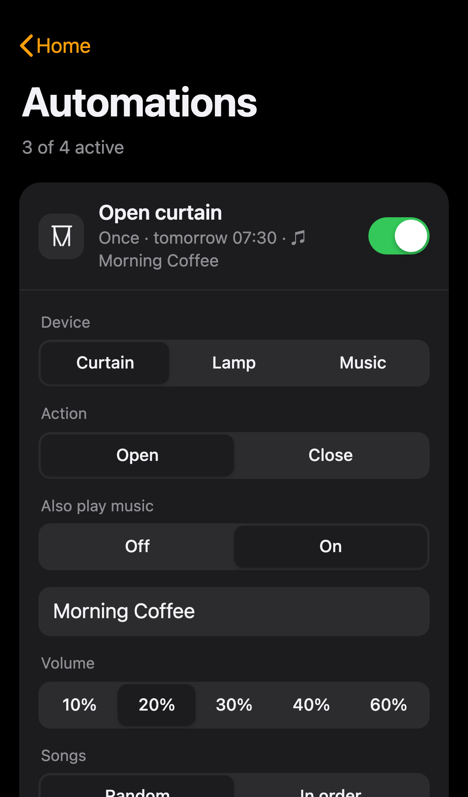
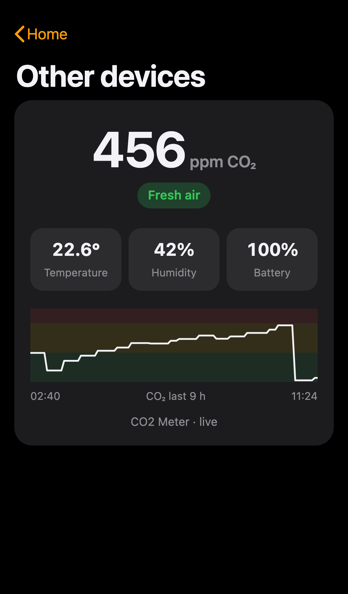

# NoFuss Home Automation

**One clean app for your curtains, lamps, music and air quality — no hubs, no accounts, no app-hopping.**

NoFuss Home turns any always-on Mac into the home controller you wish the vendor apps were.
Open it on your iPhone, add it to your home screen, and control your SwitchBot curtain, Govee lamp
and Sonos speakers (with your Spotify playlists) from one fast, good-looking page. Set up
automations like *"open the curtain at 7:30 and play my morning playlist"* in a few taps.



## What it can do

- **Curtain (SwitchBot)**: open, close, or drag to any position. It uses the Mac's own Bluetooth, so **no SwitchBot hub is needed**.
- **Lamp (Govee)**: on/off, brightness, warm/cool white and colors. **Favorites** are one-tap looks (Cozy, Reading, Movie Night…); long-press to reorder or delete, and "Save current" adds your own. Multi-zone lamps like the Govee Uplighter get **Top / Middle / Bottom** switches.
- **Heating (SwitchBot Smart Radiator Thermostat)**: room and target temperature, −/+ control, and **Constant** or **Schedule** mode. Schedule mode uses an *At home* and a *Saving* temperature plus saving times (e.g. Mon–Fri 08:30–17:30). An open-window warning is included.
- **Music (Sonos + Spotify)**: now playing with album art, play/pause/skip, volume, and all your Spotify playlists one tap away. Playback goes straight to Sonos, so it starts fast.
- **Automations**, all in one list:
  - Triggers: a time, **sunrise** or **sunset**.
  - Repeat on chosen days, or **Once** (great for alarms that change every day).
  - Curtain, lamp or music actions.
  - **"Also play music"**: open the curtain *and* start a playlist at a set volume, starting from a random song.
- **Other devices**: SwitchBot meters such as the **Meter Pro CO2** show CO2, temperature and humidity, with a 24-hour chart and a gentle hint when it's time to air the room.
- **Push notifications**: a lock-screen notification whenever an *automation* runs (or fails). Your own taps don't trigger one.
- **Feels native on iPhone**: home-screen app, dark and light mode, haptic taps (iOS 18+).
- **Private by default**: runs on your own Mac in your home network. Devices are controlled locally (Bluetooth / LAN) wherever possible.

<details>
<summary>More screenshots</summary>

| Home | Curtain | Lamp | Music | Automations | Other devices |
|---|---|---|---|---|---|
|  |  |  |  |  |  |

</details>

## Supported devices

| Device | How it connects | Notes |
|---|---|---|
| SwitchBot Curtain (1/2/3) | Bluetooth from the Mac | The Mac must be within Bluetooth range (same room is ideal). No hub. |
| SwitchBot Smart Radiator Thermostat | Bluetooth (encrypted) | Readings work right away. Control needs a one-time key: `.venv/bin/python scripts/switchbot_key.py <MAC>`. Keep the SwitchBot app closed, because it blocks the connection. |
| SwitchBot Meter / Meter Pro / Meter Pro CO2 | Bluetooth (passive) | Readings are broadcast; nothing to pair. |
| Govee Wi-Fi lamps & lights | Govee **LAN Control** (local) | Turn on "LAN Control" in the Govee app. An optional API key unlocks zone switches. |
| Sonos speakers & groups | Local network | Plays your Spotify playlists if Spotify is linked in the Sonos app. |
| Spotify | Web API (playlists only) | Free one-minute login. Playback itself runs through Sonos. |

Everything is found automatically. You don't need to type IP addresses or device IDs.

## Quick start (5 minutes)

You need a **Mac that stays on** (a Mac mini is perfect) near your devices, with Python 3.11+ (`python3 --version`).

```bash
git clone https://github.com/pxshaaa/nofuss-home-automation.git
cd nofuss-home-automation
./setup.sh
```

That's it. The script installs everything, asks once whether to detect your location (only used for
sunrise/sunset), and starts NoFuss Home in the background. It also starts automatically after a restart.

1. **Allow Bluetooth.** On the first start, macOS asks *"Python would like to use Bluetooth"* on the Mac's screen. Click **Allow**.
2. **Open it on your phone.** Use the address the script prints, e.g. `http://your-mac.local:8765`, on the same Wi-Fi.
3. **Add to Home Screen.** In Safari: Share → *Add to Home Screen*. Now it looks and feels like an app.

Your curtain, lamp, speakers and meters appear by themselves within about a minute.

## Optional extras

### Spotify playlists
1. Go to [developer.spotify.com/dashboard](https://developer.spotify.com/dashboard) and choose **Create app** (any name).
2. Tick **Web API** and add the redirect URI `http://127.0.0.1:8766/callback`.
3. On the Mac running NoFuss Home:
   ```bash
   .venv/bin/python scripts/spotify_login.py YOUR_CLIENT_ID
   ```
   A browser opens. Click **Agree**, and you're done. No client secret is needed.

Play/pause/volume on Sonos work without this; the login only adds your playlists.

### Govee extras (zones, cloud fallback)
LAN Control covers on/off, brightness and colors. For multi-zone lamps (e.g. the H60B0 Uplighter) the
Top/Middle/Bottom switches are only available through Govee's cloud. Request a key in the Govee app
(Profile → ⚙️ → *Apply for API Key*), then:
```bash
echo "YOUR-GOVEE-KEY" > ~/.config/nofuss-home/govee.key && chmod 600 ~/.config/nofuss-home/govee.key
```

### Use it away from home
The app has no login and should stay inside your home network. For remote access, use
[Tailscale](https://tailscale.com) (free): install it on the Mac and your phone, then open
`http://<mac-tailscale-name>:8765`. **Don't** port-forward it to the internet.

### Notifications (automations)
iPhones only allow push for home-screen web apps opened over **HTTPS**. With Tailscale this takes one command:
1. In the Tailscale admin, turn on **MagicDNS** and **HTTPS Certificates** (DNS page).
2. On the Mac, run:
   ```bash
   tailscale serve --bg --https=8443 http://127.0.0.1:8765
   ```
3. On your iPhone, open `https://<mac-name>.<tailnet>.ts.net:8443` in Safari, then Share → *Add to Home Screen*.

> **Using Tailscale Funnel for anything else on the same Mac?** Funnel publishes the Mac's name in public DNS,
> and phones then send `https://<mac-name>…:8443` to Tailscale's public relays, which reject it. Give the app its
> own node name instead (a second, userspace `tailscaled` that only serves this app):
> ```bash
> D=~/.config/nofuss-home/tailscale-home
> tailscaled --tun=userspace-networking --statedir=$D --socket=$D/tailscaled.sock --port=0   # run as a LaunchAgent
> tailscale --socket=$D/tailscaled.sock up --hostname=home
> tailscale --socket=$D/tailscaled.sock serve --bg --https=443 http://127.0.0.1:8765
> ```
> Then use `https://home.<tailnet>.ts.net` instead.
4. In the app, go to **Automations → 🔔 Turn on** and tap Allow. A test notification arrives right away.

### iPhone volume buttons → Sonos volume
iOS doesn't let web apps use the hardware volume buttons, but Shortcuts can do the job:
1. Shortcuts → new shortcut → **Get Contents of URL**.
2. Use `http://your-mac.local:8765/api/music/volume/up` with Method **POST**.
3. Make a second one with `/down`.
4. Add both to **Control Center** (or the Action Button).

## Settings

Everything you set in the app is stored in `data/settings.json` (git-ignored). Things you may want to change by hand:

| Key | What |
|---|---|
| `lat`, `lon` | Your location for sunrise/sunset (2 decimals is plenty). |
| `timezone` | Taken from your Mac automatically. |
| `address` | Bluetooth ID of the curtain to use (filled in automatically). |
| `music.ip` / `lamp.ip` | Filled in automatically and updated if your router changes them. |

Restart after editing: `launchctl kickstart -k gui/$(id -u)/com.nofuss-home`

## Troubleshooting

- **The curtain says "Allow Bluetooth…"**: open System Settings → Privacy & Security → Bluetooth and turn on *Python*.
- **The curtain isn't found**: move the Mac closer. Bluetooth reaches about one room. You can check that it's charged in the SwitchBot app.
- **The lamp isn't found**: make sure *LAN Control* is on for that lamp in the Govee app, and that the Mac and lamp share a network.
- **The playlists list is empty**: run the Spotify login again. Spotify logins expire after a few months.
- **Notifications don't arrive**: open the app from the **https** home-screen icon (not Safari) and press *Test* on the Automations page. If it says "Blocked", allow notifications in iPhone Settings → Notifications → Home.
- **Logs**: `tail -f ~/Library/Logs/nofuss-home.log`
- **Update**: `git pull && ./setup.sh`
- **Uninstall**: `launchctl bootout gui/$(id -u)/com.nofuss-home; rm ~/Library/LaunchAgents/com.nofuss-home.plist`, then delete the folder.

## How it works

A single small Python service (`app.py`, using aiohttp) runs on the Mac:

- It **listens** to Bluetooth advertisements for SwitchBot devices (curtain position, battery, CO2…) and connects only to send commands ([PySwitchbot](https://github.com/sblibs/pySwitchbot)).
- It controls **Govee** lamps over their local LAN API (UDP), with the cloud API only for zone switches.
- It talks to **Sonos** directly over UPnP ([SoCo](https://github.com/SoCo/SoCo)) and queues Spotify playlists through Sonos' own Spotify link.
- It runs **automations** every 20 seconds, with sunrise/sunset from [astral](https://github.com/sffjunkie/astral). Missed runs (e.g. after a restart) still fire within 15 minutes.
- It serves **one HTML file** (`web/index.html`, no build step, no frameworks) that polls `/api/state`.

PRs welcome — adding a device is usually one small class in `app.py` plus a card in `index.html`.

## License

MIT
